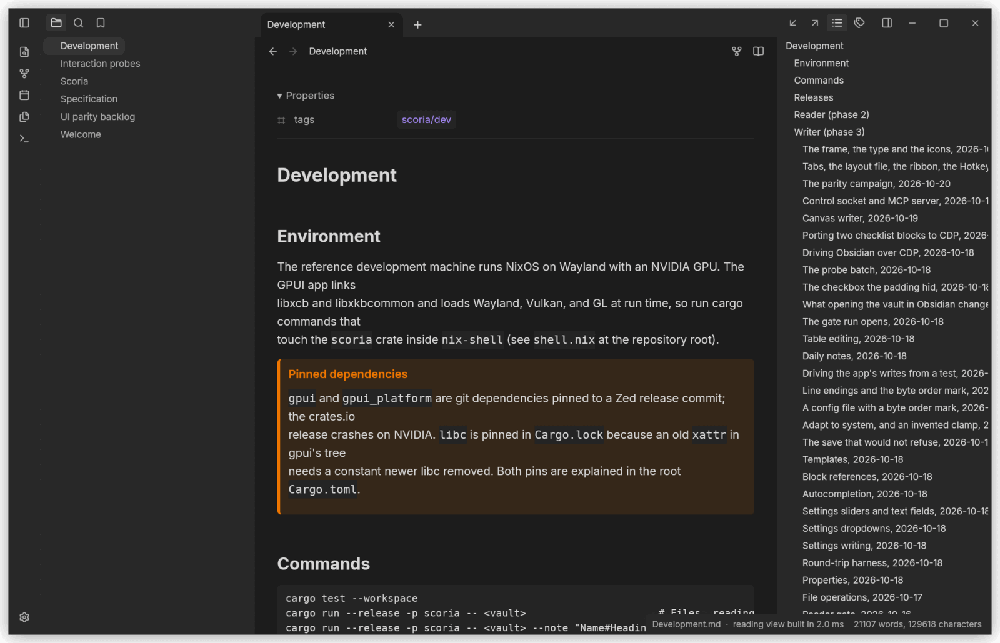
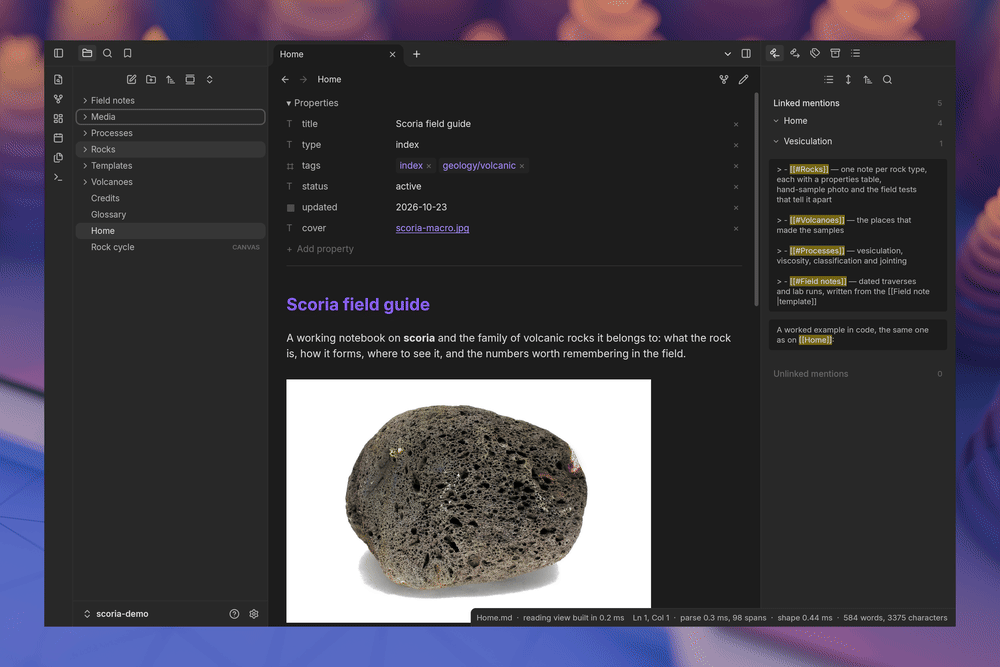
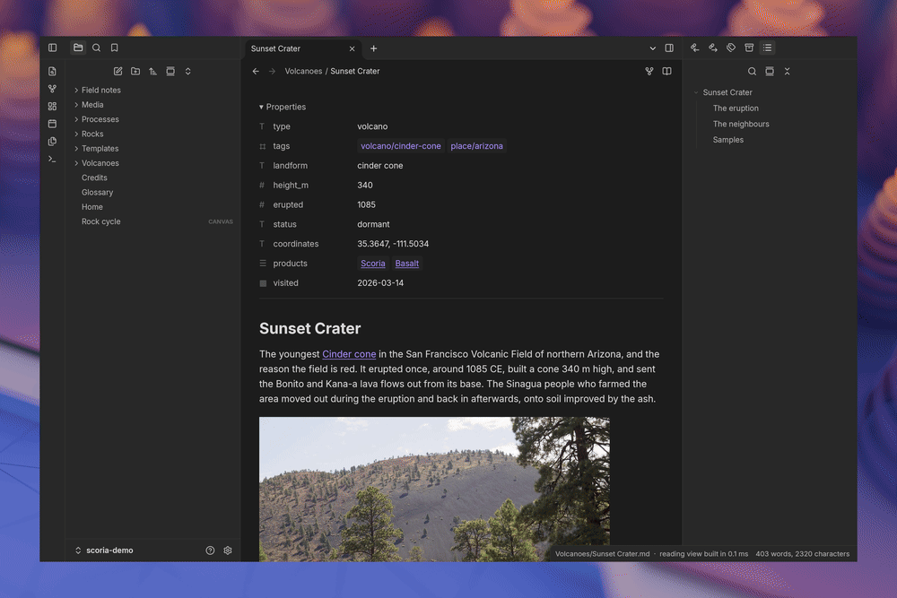
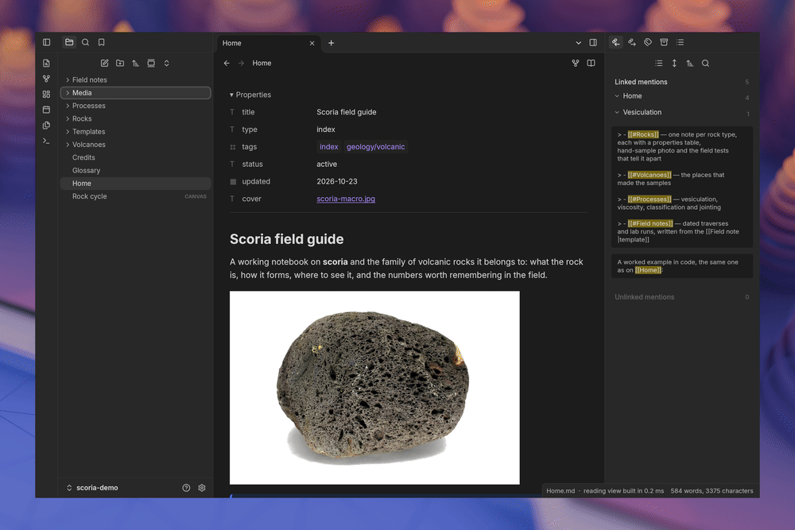
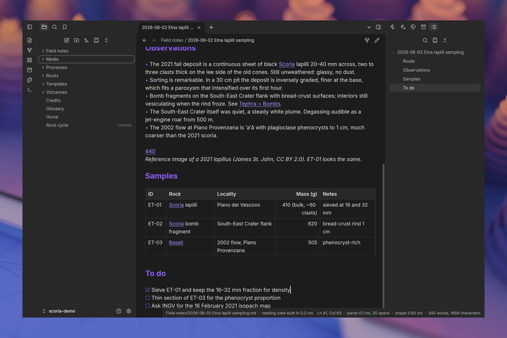
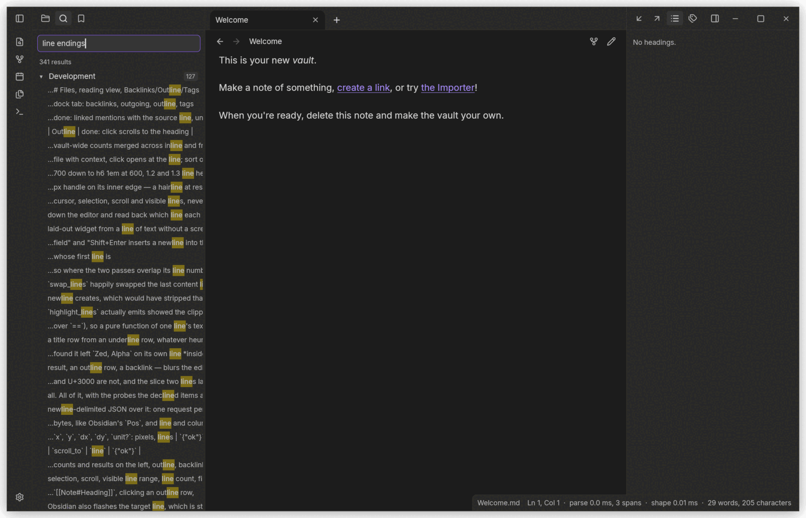
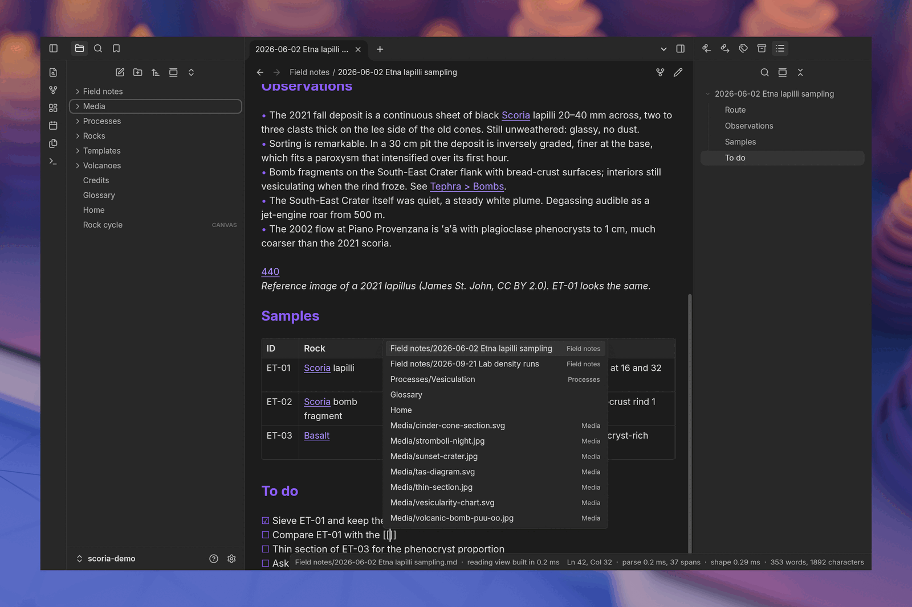

<p align="center">
  
</p>

<h1 align="center">Scoria</h1>

<p align="center"><strong>Your vault, opened natively.</strong></p>

<p align="center">
  
  
  
  
  <a href="https://github.com/ragtux/scoria/actions/workflows/ci.yml"></a>
</p>

<p align="center">
  <a href="#status">Status</a> ·
  <a href="#the-window">The window</a> ·
  <a href="#reading-a-vault">Reading</a> ·
  <a href="#images-diagrams-canvas-and-graph">Canvas and graph</a> ·
  <a href="#search-the-switcher-and-the-panes">Search</a> ·
  <a href="#writing-tabs-and-splits">Writing</a> ·
  <a href="#compatibility-tiers">Compatibility</a> ·
  <a href="#roadmap">Roadmap</a> ·
  <a href="#releases">Releases</a> ·
  <a href="https://scoria.cc">Manual</a>
</p>

Scoria is a native knowledge base written in Rust on [GPUI](https://gpui.rs), built to open
[Obsidian](https://obsidian.md) vaults unchanged: same folder, same `.obsidian` configuration,
same Markdown dialect, same `.canvas` and `.base` files. There is no import step, no conversion
and no second copy of anything. It is an independent implementation and is not affiliated with
Obsidian.



*The three-pane shell on `docs/scoria-demo`, a small field guide to scoria and the volcanic rocks
around it that ships with the repository for exactly this purpose: a typed properties table, a
photograph embedded with a width, and the note's backlinks. Obsidian's hidden window frame, its
palette, its type scale and its Lucide icons, all read off a running copy rather than guessed at.*

## Status

Reader done, Writer in progress. `scoria-markdown` parses CommonMark (all 652 spec examples), the
GitHub extensions Obsidian uses, and Obsidian's own syntax into one tree with byte spans, and renders
it to reading-view HTML that matches Obsidian 1.13.7 on 1007 of 1009 corpus notes; the metadata
cache, the editor and the link rewriter are all built from that tree. The application opens a real
vault with the three-pane shell: Files, reading view, Backlinks, Outgoing links, Outline, Tags,
Search, the quick switcher, the graph, the command palette and a Settings modal that writes. Notes
open in Live Preview or Source mode with find and replace, multiple cursors and autosave; `[[`,
`![[` and `#` autocomplete against the vault's files, aliases, headings, tags and block references; Obsidian's
sixteen table commands add, move and align rows and columns and tables are edited cell by cell; new note,
rename, move, copy and delete rewrite links the way Obsidian does, and frontmatter is an editable,
typed properties table that rewrites only the lines it changes. The main area splits into tab groups
(Split right, Split down, draggable dividers, the focus commands) and `workspace.json` records the
tree the way Obsidian does, and the Bookmarks pane reads and writes `bookmarks.json` in Obsidian's bytes. Everything is bound through
Obsidian's command ids, so a vault's `hotkeys.json` applies unchanged.

> **Keep a backup of any vault you open with it.** Reading a vault is well covered; editing is
> newer code against files you cannot get back. Until the round-trip gate is met, let Scoria read
> a vault that matters and let Obsidian write it.

## The window

The window has no desktop title bar: it draws Obsidian's hidden frame itself — the sidebar toggles,
the dock tab headers, the tab strip and the window buttons all live in one 40 px row, and the empty
parts of that row drag, zoom and menu the window. `--frame native` asks the desktop for its own
frame instead. The palette, the type scale, the 40 px headers, the 44 px ribbon and the 300 px
sidebars are the values Obsidian computes for its own shell, read over CDP from a running copy and
written down in the specification; the icons are Lucide's own drawings, which is what Obsidian names
in its DOM.

## Reading a vault



*Reading view on the vault's home note — a table, a code block, a callout, tasks — then a folder
expanded in the Files pane, a rock's note with its photograph and an embedded glossary entry, and
the Outline pane jumping to a heading.*

## Images, diagrams, canvas and graph



*Photographs and SVG charts embedded with `![[file|width]]`, an image opened as its own tab, a
`.canvas` file with text cards, note cards and image nodes joined by labelled edges, and the graph
view laying the vault out.*

## Search, the switcher and the panes



*The quick switcher's fuzzy match, Search grouping hits by note with every match highlighted and
opening one at its line, the Tags pane with nested tags and counts, and a note's Backlinks.*

## Writing, tabs and splits



*Live Preview: `[[` completes against the vault's files, aliases, headings, tags and block
references and the accepted row writes the link; find highlights every hit; then Split right and
a second note beside the first. The tab-group tree is written back to `workspace.json` in the
shape Obsidian writes.*



*Search takes Obsidian's query grammar, groups hits by note with a count, and highlights every
match in context.*



*The completion popup as `[[` opens it, listing the vault's notes, images and diagrams before a letter narrows it.*

## Running it

```
cargo run --release -p scoria -- "C:\path\to\your\vault"
cargo run --release -p scoria -- docs/scoria --synthetic 50000 --stress   # editor spike with a report
cargo run --release -p scoria -- "/path/to/vault" --control /run/user/1000/scoria.sock
cargo run --release -p scoria -- "/path/to/vault" --frame native   # the desktop's own title bar instead of Scoria's hidden frame
cargo test --workspace
```

`--control` exposes the running app on a Unix socket (on Windows too) speaking
newline-delimited JSON: open a note, run a command id, send keystrokes or
clicks, and read back a dump of the window's whole state. `scoria-mcp` wraps
that protocol as a Model Context Protocol server over stdio, so an agent can
launch Scoria, drive it and screenshot it. The recordings above were made that way:
`tools/readme-recording` drives the app over the socket inside a headless Wayland session whose
background is the desktop wallpaper, captures each step, and assembles the GIFs. Both are described in `docs/scoria/Development.md`.

## Compatibility tiers

| Tier | Goal | Plan |
| --- | --- | --- |
| 1 | Vault and format compatibility (no conversion, no data loss) | In scope, first |
| 2 | Core feature parity with Obsidian's app and 35 core plugins | In scope |
| 3 | Theme compatibility | Variable-level subset of the 1047 CSS custom properties |
| 4 | Community plugin compatibility | New native plugin API; existing JS plugins are out of scope |

The full functional specification this project implements, derived from observing Obsidian 1.12.7's
behavior, file formats, and public documentation, lives in the `docs/scoria` vault and is published
at [scoria.cc](https://scoria.cc), whose site is built from `site/` in this repository.

## Crates

| Crate | Responsibility |
| --- | --- |
| `scoria` | GPUI application: window, workspace shell, views |
| `scoria-vault` | A vault is a folder: scanning, file kinds, `.obsidian` config reads |
| `scoria-markdown` | Obsidian Flavored Markdown: CommonMark + GFM + Obsidian syntax parsed into one spanned tree, HTML renderer |
| `scoria-cache` | Metadata cache (`CachedMetadata`) and link resolution with Obsidian's rules |
| `scoria-suggest` | Autocompletion: what a line triggers, what the vault offers, and the link accepting one writes |
| `scoria-templates` | Template placeholders and the moment.js date formats they take |
| `scoria-formats` | On-disk formats: file kinds, `app.json` and friends, JSON Canvas 1.0, Bases YAML |
| `scoria-commands` | The 196 command ids and default hotkeys so vault `hotkeys.json` applies unchanged |

## Roadmap

| Phase | Gate | Status |
| --- | --- | --- |
| 1. Spike | 50k-line editor, parser conformance corpus, 2 s vault index | Done |
| 2. Reader | A daily user browses their real vault with no missing content | Done: Files, reading view, Backlinks, Outgoing links, Outline, Tags, Search, quick switcher, graph, command palette, read-only Settings, file watching |
| 3. Writer | The vault round-trips byte-identical after a week of mixed use in both apps | In progress: Source mode, Live Preview, find and replace, file operations with link rewriting, properties, autocompletion, table editing, block references, templates, daily notes, tab groups, bookmarks, the round-trip harness and the Settings toggles are done; and every Settings control Obsidian offers as one writes; file recovery is out of phase 3 |
| 4. Parity | Core plugin parity | Not started: canvas, bases, PDF, math, themes subset, URI and CLI |
| 5. Ecosystem | Native plugin SDK | Not started |

Progress notes, gates and the per-item status live in `docs/scoria/Development.md`.

## Releases

Pushing a `v*` tag builds the `scoria` binary on both forges and attaches the archives with a
`SHA256SUMS` file:

- [GitHub releases](https://github.com/ragtux/scoria/releases) — Linux x86_64, Windows x86_64, macOS arm64
- [git.ragtux.com releases](https://git.ragtux.com/ragtux/scoria/releases) — Linux x86_64

Each release carries every archive twice: once named for its tag, and once under a name with no
version in it, which is the address that always resolves to the newest release and the one
[scoria.cc](https://scoria.cc/download/) links:

- `https://github.com/ragtux/scoria/releases/latest/download/scoria-linux-x86_64.tar.gz`
- `https://github.com/ragtux/scoria/releases/latest/download/scoria-windows-x86_64.zip`
- `https://github.com/ragtux/scoria/releases/latest/download/scoria-macos-aarch64.tar.gz`

There is no installer: unpack the archive and run `scoria /path/to/vault`. Linux x86_64 is the
build that runs on the reference machine and gets the hours; since 0.3.1 the Windows and macOS
builds are run on real hardware too, each drawing its own platform's window — the hidden frame on
Windows 11, the traffic lights and the platform text system on Apple silicon. Nothing is
code-signed for macOS or Windows — see `docs/scoria/Development.md`.

Verify a download: `sha256sum -c --ignore-missing SHA256SUMS` checks the archive against the
checksums the workflow wrote; `gh attestation verify <archive> --repo ragtux/scoria` checks GitHub's
build provenance, which ties the archive to the workflow run and the commit it was built from. When
a release carries `SHA256SUMS.asc`, `gpg --verify SHA256SUMS.asc SHA256SUMS` checks the maintainer's
signature. That key is `69BF AA44 7DAC E6C3 EF02  6CBA 4EA6 7A61 88DA 92BD`, `ragtux
<ragtux@outlook.com>`, which `gpg --keyserver keys.openpgp.org --recv-keys 4EA67A6188DA92BD`
fetches; the release notes repeat the fingerprint that signed each release. Security problems go through
[SECURITY.md](SECURITY.md), not the issue tracker.

## License

MIT. See [LICENSE](LICENSE).
